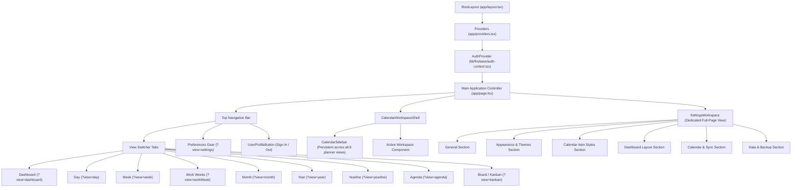

# PLANORAMA — Complete Feature Audit & Technical Documentation

**Generated on:** October 30, 2026  
**Auditor:** Antigravity AI Engineering Assistant  
**Repository:** [planorama](file:///c:/Users/Kweng/planorama)  
**Branch:** `security-remediation`  
**Framework & Stack:** Next.js 15.5.28 (App Router), React 19.1.0, TypeScript 5.9.2, Firebase 13.1.0, Vitest 3.2.7

---

## 1. Executive Summary

Planorama is a personal and multi-calendar planning system constructed with a neo-brutalist design aesthetic (Bricolage Grotesque headings, Lexend typography, warm cream canvas `#fff4e2`, high-contrast dark borders `2px solid #1e1e24`, and sharp offset shadows).

### Core Architectural Paradigm
- **Client-Side SPA Architecture within Next.js App Router:** The entire planner runs inside a unified client-side application shell at [`app/page.tsx`](file:///c:/Users/Kweng/planorama/app/page.tsx) with state-driven view transitions controlled via URL query parameter (`?view=dashboard|day|week|workWeek|month|year|yearline|agenda|kanban|settings`).
- **Unified Calendar Layout Contract:** The [`CalendarWorkspaceShell`](file:///c:/Users/Kweng/planorama/app/components/calendar/calendar-workspace-shell.tsx) wraps all planner views with a single shared [`CalendarSidebar`](file:///c:/Users/Kweng/planorama/app/components/calendar/calendar-sidebar.tsx), eliminating duplicate DOM nodes, coordinating active calendar visibility filters, and managing the collapsible sidebar state.
- **Data Persistence:**
  - **Local Tasks, Events & Appointments:** Persisted on the client using IndexedDB (`planorama-local`, object store `tasks`) via [`lib/schedule/local-store.ts`](file:///c:/Users/Kweng/planorama/lib/schedule/local-store.ts), with fallback to `window.localStorage` (`planorama:tasks:v1`).
  - **Habits & Habit Check-ins:** Persisted in `localStorage` (`planorama:habits:v1` and `planorama:habit-checkins:v1`).
  - **Preferences & Themes:** Persisted in `localStorage` (`planorama:preferences:v1`).
  - **Google OAuth Credentials & Sync Metadata:** Persisted server-side using AES-256-GCM encryption in Google Cloud Firestore REST (`users/${userId}/integrations/google`) or fallback filesystem (`.planorama/storage/users/${userId}/google_data.json.enc`).
- **Two-Way Google Calendar Synchronization:** Durable server-side sync with multi-account support, account-scoped sync tokens, ETag conflict resolution, distributed sync locking via Firestore preconditions, and a client-side offline action queue with tombstone resurrection prevention.

---

## 2. Complete Application Feature Inventory

### A. Navigation & Application Structure
- **Global Top Navigation Bar (`app/page.tsx`):**
  - **Views:** Dashboard, Day, Week, Work Weeks, Month, Year, Yearline, Agenda, Board (Kanban).
  - **Authoritative Control:** Sole place to switch primary calendar views across the entire application. Internal calendar header duplicate switchers have been removed.
  - **Quick Action Buttons:** "Add Task" button (opens Unified Create Modal), Google Sync indicator/trigger button, Preferences gear button (`view === "settings"`), and Firebase Auth Profile Button (`UserProfileButton`).
- **Settings Workspace (`app/components/settings/settings-workspace.tsx`):**
  - Full-page settings workspace displayed when `view === "settings"`.
  - Sections: General, Appearance & Themes, Calendar Item Styles, Dashboard, Calendar & Sync, Data & Backup.
  - Retains "← Back to Planner" button returning to the previously active view.

### B. Dashboard Module (`app/components/dashboard/dashboard-view.tsx`)
- **Widgets:**
  1. `daily_overview` ([`daily-overview-widget.tsx`](file:///c:/Users/Kweng/planorama/app/components/dashboard/daily-overview-widget.tsx)): Date header, Due Today count, Completed count, Overdue count, Progress percentage bar, and "Add Task for Today" button.
  2. `todays_focus` ([`todays-focus-widget.tsx`](file:///c:/Users/Kweng/planorama/app/components/dashboard/todays-focus-widget.tsx)): Prioritized list of tasks due today. Filterable, inline completion checkbox, item style rendering, click to open edit modal, delete action.
  3. `daily_habits` ([`daily-habits-widget.tsx`](file:///c:/Users/Kweng/planorama/app/components/daily-habits-widget.tsx)): Habit tracker with today's checklist, streak counts, completion rate percentage, add new habit modal, and delete habit action.
  4. `upcoming` ([`upcoming-widget.tsx`](file:///c:/Users/Kweng/planorama/app/components/dashboard/upcoming-widget.tsx)): Chronological schedule for the next 7 days grouped by date. Includes "View Calendar" shortcut jumping to Month view.
  5. `mini_calendar` ([`mini-calendar-widget.tsx`](file:///c:/Users/Kweng/planorama/app/components/dashboard/mini-calendar-widget.tsx)): Interactive monthly calendar preview with date dots, theme color rendering, and click-to-filter date.
  6. `weekly_progress` ([`weekly-progress-widget.tsx`](file:///c:/Users/Kweng/planorama/app/components/dashboard/weekly-progress-widget.tsx)): Weekly completion metrics, total tasks, completed percentage, and day-of-week breakdown (Mon–Sun).
- **Customization & Reordering:**
  - Reorder via direct drag-and-drop on the dashboard grid.
  - Reorder and toggle visibility via [`DashboardCustomizationModal`](file:///c:/Users/Kweng/planorama/app/components/dashboard/dashboard-customization-modal.tsx) (modal with drag handles, CaretUp/CaretDown buttons, and Eye/EyeSlash toggles).
  - Restore defaults button.
  - Persisted in user preferences under `preferences.dashboardWidgets`.

### C. Calendar Views
1. **Day View ([`day-view.tsx`](file:///c:/Users/Kweng/planorama/app/components/calendar/day-view.tsx)):**
   - Displays: Header with Prev/Today/Next controls, native date picker (`<input type="date">`), all-day tasks row, and a 24-hour vertical timeline grid (60px/hour).
   - Features: Real-time red current-time indicator line (when viewing today), multi-column overlapping event layout algorithm ([`day-layout.ts`](file:///c:/Users/Kweng/planorama/lib/calendar/day-layout.ts)), click empty slot to create event at clicked hour, click event card to open detail modal, lock icon on read-only events.
2. **Week View ([`week-view.tsx`](file:///c:/Users/Kweng/planorama/app/components/calendar/week-view.tsx)):**
   - Displays: 7-day columns (Sunday–Saturday or Monday–Sunday depending on `weekStartsOn`).
   - Toolbar: Prev week, Today, Next week, direct date picker, and segmented mode switcher: `7-Day Timeline` vs `Status Kanban`.
   - Timeline Mode: Sticky day column headers, all-day row, 24-hour time grid, multi-column overlap layout, red current-time indicator on today's column.
   - Kanban Mode: 3 status columns (To Do, In Progress, Done) for the active week with HTML5 drag-and-drop task movement.
3. **Work Weeks View ([`week-view.tsx`](file:///c:/Users/Kweng/planorama/app/components/calendar/week-view.tsx) with `isWorkWeek = true`):**
   - Displays: 5 weekday columns (Monday through Friday) generated via [`getWorkWeekDays`](file:///c:/Users/Kweng/planorama/lib/calendar/date-utils.ts).
   - Weekday Selection: If current date or anchor falls on Saturday or Sunday, navigation automatically opens the Monday–Friday of that week.
   - Weekend Task Retention: Weekend tasks (Saturday/Sunday) are excluded from the 5-day grid display but retain their original `dueDate` and times without being rescheduled.
   - Toolbar: `5-Day Timeline` vs `Status Kanban` segmented toggle.
4. **Month View ([`month-view.tsx`](file:///c:/Users/Kweng/planorama/app/components/calendar/month-view.tsx)):**
   - Displays: Full-month 7-column calendar grid.
   - Navigation: Prev/Next month buttons, active calendar count indicator pill.
   - Day Cells: Shows date number, weekend styling, today badge, up to 3 visible task chips, and `+N more` badge.
   - Interactions: Click day cell to select date, double-click day cell to quick add task for that date, click task chip to open detail modal.
5. **Year View ([`year-view.tsx`](file:///c:/Users/Kweng/planorama/app/components/calendar/year-view.tsx)):**
   - Displays: 12-month calendar tile grid (January through December) with month numbers and mini-weekdays.
   - Month Theming: Custom header colors, accent borders, or full tile tints based on `resolvedTheme`.
   - Lower Section: Displays a Selected Date Banner and an interactive Weekly Planner embedded directly below the 12-month grid.
   - Navigation: Previous Year (`←`), This Year, Next Year (`→`).
6. **Yearline View (`app/page.tsx` line 1455+):**
   - Displays: A horizontal 365/366-day continuous timeline strip grouped into 12 monthly sections.
   - Navigation & Interactions: Click-and-drag horizontal pan (mouse drag-to-scroll with inertia tracking), click date cell to jump and scroll into view, Selected Date Quick Banner below, and embedded Weekly Planner below.
7. **Agenda View ([`agenda-view.tsx`](file:///c:/Users/Kweng/planorama/app/components/calendar/agenda-view.tsx)):**
   - Displays: Chronological list of scheduled items grouped by day ("Today", "Tomorrow", "Thursday, Oct 29, 2026").
   - Filter Chip: Active date filter banner ("Filtered: October 29, 2026") with clear `✕` button.
   - Actions: Checkbox to toggle task completion, click item to view/edit details.
8. **Board / Kanban View (`app/page.tsx` line 2530+):**
   - Columns: "To Do" (`open`), "In Progress" (`in_progress`), "Done" (`completed`).
   - Movement: HTML5 drag-and-drop between columns + touch-friendly `<select>` dropdown on each tile for mobile devices.
   - Task Tiles: Priority color accent strip, pinned pin icon, personal badge, whenever badge, label chips, overdue badge, click title to edit, `+ Add task` button per column.

### D. Tasks Feature Breakdown
- **Data Model:** [`PlannerTask`](file:///c:/Users/Kweng/planorama/lib/schedule/types.ts)
- **Implemented & Functional:**
  - Title, notes/description, location, due date (`YYYY-MM-DD`), due time (`HH:mm`).
  - Priority: `p1` (Urgent), `p2` (High), `p3` (Medium), `p4` (Low), `none`.
  - Status: `open`, `in_progress`, `completed`.
  - Pinned state: `isPinned: boolean` (renders pin badge and prioritizes item in list).
  - Timing preference: `scheduled` vs `whenever` (tasks without a strict time commitment).
  - Category / Personal: `isPersonal: boolean`.
  - Labels: Fully functional CRUD via `labels: TaskLabel[]` and `task.labelIds`.
  - Recurring tasks: Automatic creation of next occurrence on completion (`daily`, `weekly`, `monthly`).
  - Completion toggle: Inverts status, updates storage, and triggers next recurring task generation.
  - Overdue handling: Detects `dueDate < todayKey` and renders prominent overdue chip.
  - Sorting: Sort by due date, priority, or newest (configured via preferences).
  - Filtering: Filter by search query, calendar source, label, or date.
  - Deletion: Confirmation dialog and removal from storage + Google sync queue.
- **Partially Implemented:**
  - Projects: `task.projectId` exists in the data model and task validation, and projects are preserved in JSON backups. However, there is no dedicated Projects manager UI or project sidebar.
  - Recurrence: `yearly` recurrence is accepted in types and dropdowns, but `nextOccurrenceDate` only increments daily, weekly, and monthly (yearly returns the same date).
- **Missing / Not Implemented:**
  - Subtasks / Checklists within individual tasks.
  - Task duplication / clone button.
  - Natural-language date parsing (e.g. typing "Meet tomorrow at 3pm" does not extract date/time).
  - Browser Push / OS Web Notifications.

### E. Events Feature Breakdown
- **Creation & Management:** Via Unified Create Modal ([`unified-create-modal.tsx`](file:///c:/Users/Kweng/planorama/app/components/calendar/unified-create-modal.tsx)).
- **Fields:** Title, start date, start time, end date, end time, duration (minutes), all-day toggle, calendar selector (default or connected Google calendars), location, attendees list (`email`, `displayName`), notes, and privacy toggle (Busy vs Free).
- **Synchronization:** Two-way sync with Google Calendar API via `POST /api/integrations/google/sync`.
- **Read-Only Protection:** Events on read-only calendars (`accessRole: "reader"` or `"freeBusyReader"`) display a lock icon, prevent editing/deletion, and are protected by server-side authorization.

### F. Appointment Schedules Feature Breakdown
- **Definition & Architecture:**
  - Configured via Unified Create Modal tab "Appointment Schedule".
  - Data structure: [`AppointmentSchedule`](file:///c:/Users/Kweng/planorama/lib/schedule/appointment-types.ts) with duration, weekly availability (`dayOfWeek`, `startTime`, `endTime`), time zone, scheduling window days, buffer minutes, meeting method (`google_meet`, `in_person`, `phone`, `custom`), min advance notice hours, max bookings per day.
  - Stored in client `localStorage` under `planorama:appointment_schedules:v1`.
- **Slot Calculation:** [`calculateAvailableSlots`](file:///c:/Users/Kweng/planorama/lib/schedule/appointment-service.ts) computes available booking slots against existing planner tasks and checks for collisions.
- **Calendar Placement:** When saved in `app/page.tsx`, it creates a single placeholder tile on the calendar (`title: "Availability: ..."`, `itemType: "appointment"`).
- **Critical Audit Finding:** Appointment schedules are **internal calendar availability blocks and slot calculation templates only**. There is **NO public booking page**, NO external booking URL, NO guest booking submission API, and NO automatic calendar invites dispatched to guests.

### G. Board and Kanban
- Implemented in `app/page.tsx` line 2530+ and `week-view.tsx` line 730+.
- Features: 3 columns (`open`, `in_progress`, `completed`), HTML5 drag-and-drop, mobile touch dropdown selector, quick add per column, real-time persistence to IndexedDB/localStorage, and Google Calendar sync dispatch on status movement.

### H. Preferences & Customization Workspace
- Full-page settings workspace ([`settings-workspace.tsx`](file:///c:/Users/Kweng/planorama/app/components/settings/settings-workspace.tsx)).
- **Settings Available:**
  1. **General:** Week start day (`Sunday = 0`, `Monday = 1`, `Saturday = 6`), default sort mode, default task priority, custom task labels CRUD, disable/enable priority options.
  2. **Appearance & Themes:** 4 theme presets (`Colorful`, `Bold Pop`, `Soft Pastel`, `Minimal`), month color mode (`headers` vs `tiles`), custom month color editor for all 12 months, calendar background, weekend background, today highlight, and selected date highlight.
  3. **Calendar Item Styles ([`item-colors-settings.tsx`](file:///c:/Users/Kweng/planorama/app/components/calendar/item-colors-settings.tsx)):**
     - Global tile style selector: Vibrant Solid, Soft Pastel, Color Pop, Outline, Minimal.
     - Independent category color controls: Events, Tasks, Appointment Schedules.
     - Independent text color and background color pickers with contrast checker and WCAG AA warning.
     - Side-by-side live preview card.
  4. **Dashboard:** Reorder widgets, toggle visibility, restore default layout.
  5. **Calendar & Sync ([`google-calendar-settings.tsx`](file:///c:/Users/Kweng/planorama/app/components/google-calendar-settings.tsx)):** Connect Google accounts, view multi-account connection status, configure calendar sync direction (`two_way`, `import_only`, `export_only`), default calendar assignment, and manual sync trigger.
  6. **Data & Backup:** Export complete JSON backup, import JSON backup with conflict detection, and saved task templates.
- **Persistence:** Stored in client `localStorage` under `planorama:preferences:v1`. Does not automatically sync across devices without manual JSON export/import.

### I. Calendar Sidebar ([`calendar-sidebar.tsx`](file:///c:/Users/Kweng/planorama/app/components/calendar/calendar-sidebar.tsx))
- **Unified Workspace Integration:** Hosted inside `CalendarWorkspaceShell`, shared across all 8 planner views.
- **Components:**
  - Create dropdown: `+ Create` button opening Event, Task, or Appointment Schedule mode.
  - Mini Calendar: Navigable month preview, date dot indicators for active tasks, date selection.
  - Search Filter: Real-time search query filtering calendars by name or email.
  - My Calendars: Primary account calendars with visibility checkboxes and color chips.
  - Client Calendars: Distinct section for authorized client calendars (where `accountEmail !== primaryAccountEmail`) for Virtual Assistants.
  - Other Calendars: Read-only or external holiday calendars.
  - Sync Status: Shows last synced time, sync error alerts, and manual `Sync Now` spin button.
  - Collapse / Expand: Collapsible on desktop with attached chevron button; slides in as an off-canvas drawer on mobile (`<768px`) with dark backdrop overlay.

### J. Google Calendar Integration
- **OAuth 2.0 Flow:**
  - `GET /api/auth/google`: Initiates flow with session-bound HMAC-SHA256 signed state, CSRF nonce, returnUrl validation, and `prompt=select_account`.
  - `GET /api/auth/google/callback`: Verifies signed state, exchanges code for tokens, encrypts tokens at rest with AES-256-GCM, and binds them to the user's ID.
- **Multi-Account Virtual Assistant Support:** Stores multiple connected accounts in Firestore/filesystem under `accounts: Record<string, StoredGoogleAccount>`.
- **Sync Engine (`POST /api/integrations/google/sync`):**
  - Distributed sync locking with 60-second mutex in Firestore to prevent race conditions.
  - Calendar-scoped sync tokens (`${accountId}:${calendarId}`) for incremental delta sync.
  - Recovery from 410 Gone (expired sync token) via full sync reconciliation.
  - Server-verified calendar permissions: Client claims are ignored; access roles (`owner`, `writer`, `reader`, `freeBusyReader`) are derived from Google API.
  - Conditional event updates using ETags to prevent silent overwrites.
  - Read-only calendar enforcement: Write or delete attempts to reader calendars are blocked on the server.
  - Privacy redaction: `availability_only` calendars redact summaries to "Busy".
  - Offline sync queue (`lib/google-calendar/sync-queue.ts`): Coalesces operations and records tombstones in `localStorage` to prevent resurrection of deleted events.

### K. User Accounts, Sessions & Data Isolation
- **Authentication:**
  - Firebase Authentication (`lib/firebase/auth-context.tsx`) with Google Sign-In popup.
  - Anonymous Guest Mode: Generates guest session (`guest_<uuid>`) if unauthenticated.
  - Session Binding (`POST /api/auth/session`): Verifies client Firebase ID token and signs an HTTP-only cookie (`planorama_session`).
  - Session Fixation Protection: Upgrades guest session to authenticated Firebase UID on login and migrates connected Google credentials.
- **Data Isolation:**
  - Server-side tokens and metadata are strictly partitioned by `users/${userId}/`.
  - Client-side IndexedDB and localStorage are scoped by the browser origin.

---

## 3. Feature Status Matrix

| Feature | Category | Status | Relevant Files | Behavioral Summary | Evidence |
| :--- | :--- | :--- | :--- | :--- | :--- |
| **Global Top Navigation** | Navigation | **Fully implemented** | [`app/page.tsx`](file:///c:/Users/Kweng/planorama/app/page.tsx) | Authoritative switch for all 9 application views. | Unit test in `weekly-workspace.test.ts:544` |
| **Workspace Shell** | Architecture | **Fully implemented** | [`calendar-workspace-shell.tsx`](file:///c:/Users/Kweng/planorama/app/components/calendar/calendar-workspace-shell.tsx) | Single persistent sidebar instance wrapping all views. | Verified in `page.tsx:2349` |
| **Daily Overview Widget** | Dashboard | **Fully implemented** | [`daily-overview-widget.tsx`](file:///c:/Users/Kweng/planorama/app/components/dashboard/daily-overview-widget.tsx) | Stats for due, completed, overdue, percent bar, quick add. | Unit test in `dashboard-audit.test.ts:39` |
| **Today's Focus Widget** | Dashboard | **Fully implemented** | [`todays-focus-widget.tsx`](file:///c:/Users/Kweng/planorama/app/components/dashboard/todays-focus-widget.tsx) | Priority-sorted list of today's tasks with inline actions. | Unit test in `dashboard-audit.test.ts:86` |
| **Daily Habits Tracker** | Dashboard | **Fully implemented** | [`daily-habits-widget.tsx`](file:///c:/Users/Kweng/planorama/app/components/daily-habits-widget.tsx), [`habit-service.ts`](file:///c:/Users/Kweng/planorama/lib/habits/habit-service.ts) | Daily checklist, streak calculation, add habit modal. | 17 unit tests in `habit-service.test.ts` |
| **Upcoming Widget** | Dashboard | **Fully implemented** | [`upcoming-widget.tsx`](file:///c:/Users/Kweng/planorama/app/components/dashboard/upcoming-widget.tsx) | 7-day chronological schedule with "View Calendar" link. | Unit test in `dashboard-audit.test.ts:133` |
| **Mini Calendar Widget** | Dashboard | **Fully implemented** | [`mini-calendar-widget.tsx`](file:///c:/Users/Kweng/planorama/app/components/dashboard/mini-calendar-widget.tsx) | Compact month grid with date dots and selection. | Unit test in `dashboard-audit.test.ts:168` |
| **Weekly Progress Widget** | Dashboard | **Fully implemented** | [`weekly-progress-widget.tsx`](file:///c:/Users/Kweng/planorama/app/components/dashboard/weekly-progress-widget.tsx) | Metrics and day-of-week breakdown (Mon–Sun). | Unit test in `dashboard-audit.test.ts:193` |
| **Dashboard Customization**| Dashboard | **Fully implemented** | [`dashboard-customization-modal.tsx`](file:///c:/Users/Kweng/planorama/app/components/dashboard/dashboard-customization-modal.tsx) | Reorder via drag & drop or arrows, toggle visibility. | 9 unit tests in `dashboard-customization.test.ts` |
| **Day View** | Calendar | **Fully implemented** | [`day-view.tsx`](file:///c:/Users/Kweng/planorama/app/components/calendar/day-view.tsx), [`day-layout.ts`](file:///c:/Users/Kweng/planorama/lib/calendar/day-layout.ts) | 24h timeline, current-time red line, overlapping layout. | 13 unit tests in `day-workspace.test.ts` |
| **Week View (Timeline)** | Calendar | **Fully implemented** | [`week-view.tsx`](file:///c:/Users/Kweng/planorama/app/components/calendar/week-view.tsx) | 7-day hourly grid, all-day row, current-time indicator. | Unit test in `weekly-workspace.test.ts` |
| **Week View (Kanban)** | Calendar | **Fully implemented** | [`week-view.tsx`](file:///c:/Users/Kweng/planorama/app/components/calendar/week-view.tsx) | 3-column status board for the active week with drag & drop. | Unit test in `weekly-workspace.test.ts:730` |
| **Work Weeks View** | Calendar | **Fully implemented** | [`week-view.tsx`](file:///c:/Users/Kweng/planorama/app/components/calendar/week-view.tsx), [`date-utils.ts`](file:///c:/Users/Kweng/planorama/lib/calendar/date-utils.ts) | 5 weekday columns (Mon–Fri); weekend tasks kept intact. | Unit test in `weekly-workspace.test.ts:391` |
| **Month View** | Calendar | **Fully implemented** | [`month-view.tsx`](file:///c:/Users/Kweng/planorama/app/components/calendar/month-view.tsx) | Month grid with +N more chips, double-click to add. | 5 unit tests in `month-workspace.test.ts` |
| **Year View** | Calendar | **Fully implemented** | [`year-view.tsx`](file:///c:/Users/Kweng/planorama/app/components/calendar/year-view.tsx) | 12-month overview tiles + selected date banner + weekly planner. | 6 unit tests in `year-workspace.test.ts` |
| **Yearline View** | Calendar | **Fully implemented** | [`app/page.tsx`](file:///c:/Users/Kweng/planorama/app/page.tsx) line 1455+ | Continuous 365-day horizontal strip with drag-to-pan. | Code verified in `page.tsx:1415-1475` |
| **Agenda View** | Calendar | **Fully implemented** | [`agenda-view.tsx`](file:///c:/Users/Kweng/planorama/app/components/calendar/agenda-view.tsx) | Chronological list grouped by day with date filter chip. | 10 unit tests in `agenda-workspace.test.ts` |
| **Board / Kanban View** | Board | **Fully implemented** | [`app/page.tsx`](file:///c:/Users/Kweng/planorama/app/page.tsx) line 2530+ | 3 status columns, HTML5 drag-and-drop, mobile select. | Code verified in `page.tsx:2530-2640` |
| **Task Creation & Editing** | Tasks | **Fully implemented** | [`unified-create-modal.tsx`](file:///c:/Users/Kweng/planorama/app/components/calendar/unified-create-modal.tsx), [`task-service.ts`](file:///c:/Users/Kweng/planorama/lib/schedule/task-service.ts) | Title, notes, priority, timing, status, labels. | 20 unit tests in `task-service.test.ts` |
| **Task Recurrence (D/W/M)** | Tasks | **Fully implemented** | [`app/page.tsx`](file:///c:/Users/Kweng/planorama/app/page.tsx) line 623 | Auto-spawns next task on completion for daily/weekly/monthly. | Code verified in `page.tsx:1553-1572` |
| **Task Recurrence (Yearly)**| Tasks | **Broken** | [`app/page.tsx`](file:///c:/Users/Kweng/planorama/app/page.tsx) line 623 | Yearly recurrence option exists but does not increment year. | Code inspected in `nextOccurrenceDate` |
| **Task Projects** | Tasks | **Partially implemented** | [`types.ts`](file:///c:/Users/Kweng/planorama/lib/schedule/types.ts), [`page.tsx`](file:///c:/Users/Kweng/planorama/app/page.tsx) | `projectId` field exists, but no dedicated project manager UI. | Verified in `types.ts` and `page.tsx:304` |
| **Subtasks / Checklists** | Tasks | **Missing** | N/A | No subtask fields or checklist items inside individual tasks. | Grep confirms 0 occurrences |
| **Task Duplication** | Tasks | **Missing** | N/A | No duplicate/clone action exists in task detail modal. | Code inspection of detail modal |
| **Appointment Schedules** | Calendar | **Partially implemented** | [`appointment-service.ts`](file:///c:/Users/Kweng/planorama/lib/schedule/appointment-service.ts) | Local availability template and slot calculator; no public URL. | Code verified in `appointment-service.ts` |
| **Public Guest Booking** | Bookings | **Missing** | N/A | No external booking route (`/book/...`) or guest booking API. | Route inspection confirmed |
| **Calendar Themes** | Preferences | **Fully implemented** | [`calendar-themes.ts`](file:///c:/Users/Kweng/planorama/lib/calendar/calendar-themes.ts) | 4 presets, headers/tiles mode, 12 custom month colors. | 10 unit tests in `calendar-themes.test.ts` |
| **Item Styles & Colors** | Preferences | **Fully implemented** | [`item-color.ts`](file:///c:/Users/Kweng/planorama/lib/calendar/item-color.ts), [`item-colors-settings.tsx`](file:///c:/Users/Kweng/planorama/app/components/calendar/item-colors-settings.tsx) | 5 tile styles, independent text/bg colors, contrast checker. | 44 unit tests in `item-color.test.ts` |
| **Backup Export & Import** | Data | **Fully implemented** | [`app/page.tsx`](file:///c:/Users/Kweng/planorama/app/page.tsx) line 996+ | Single JSON export/import with validation and conflict checks. | Code verified in `page.tsx:996-1110` |
| **Calendar Sidebar** | UI / Sidebar | **Fully implemented** | [`calendar-sidebar.tsx`](file:///c:/Users/Kweng/planorama/app/components/calendar/calendar-sidebar.tsx) | Mini-cal, My/Client/Other groups, search, mobile drawer. | 10 unit tests in `dashboard-calendar-sidebar.test.ts` |
| **Google OAuth Flow** | Integration | **Fully implemented** | [`app/api/auth/google/route.ts`](file:///c:/Users/Kweng/planorama/app/api/auth/google/route.ts), `callback/route.ts` | HMAC signed state, CSRF nonce, returnUrl validation. | 34 unit tests in `google-calendar.test.ts` |
| **Token Encryption (AES-GCM)**| Security | **Fully implemented** | [`lib/server/crypto.ts`](file:///c:/Users/Kweng/planorama/lib/server/crypto.ts) | AES-256-GCM authenticated encryption at rest for tokens. | Tested in `google-calendar.test.ts:20` |
| **Two-Way Google Sync** | Integration | **Fully implemented** | [`app/api/integrations/google/sync/route.ts`](file:///c:/Users/Kweng/planorama/app/api/integrations/google/sync/route.ts) | Delta sync tokens, ETag updates, lock mutex, 410 recovery. | Wire protocol tested in `pre-merge-validation.test.ts` |
| **Live Google API Sync** | Integration | **Unverified in CI** | `www.googleapis.com` | Code exists and passes wire tests, but live Google sync requires real client credentials. | Requires production credentials |
| **Firebase Auth Binding** | Auth | **Fully implemented** | [`auth-context.tsx`](file:///c:/Users/Kweng/planorama/lib/firebase/auth-context.tsx), [`session.ts`](file:///c:/Users/Kweng/planorama/lib/server/session.ts) | Google popup sign-in, ID token verification, session upgrade. | Tested in `firebase-verify.ts` and `session.ts` |
| **Firestore Cloud Storage** | Persistence | **Fully implemented** | [`firestore-store.ts`](file:///c:/Users/Kweng/planorama/lib/server/firestore-store.ts) | REST API via Service Account JWT, distributed locks. | 11 unit tests in `storage-remediation.test.ts` |
| **Cloud Task Sync (Non-Google)**| Persistence | **Missing** | N/A | Non-Google local tasks exist only in browser IndexedDB/localStorage; no cloud DB sync. | Code inspection of `local-store.ts` |
| **Web Push Notifications** | Notifications | **Missing** | N/A | No browser push, service worker notifications, or email alerts. | Grep confirms 0 occurrences |
| **Natural Language Parsing**| Tasks | **Missing** | N/A | No date/time NLP parser library installed or implemented. | `package.json` inspection |
| **Global Keyboard Shortcuts**| UX | **Missing** | N/A | Only Escape (close modals) and Enter/Space (accessibility) exist. | Code inspection in `page.tsx` |

---

## 4. Page and Navigation Map

Planorama operates as a single-page application (SPA) controller powered by Next.js App Router:

### URL Query Parameters Recognized by `app/page.tsx`
- `?view=<id>`: Activates specific workspace (`dashboard`, `day`, `week`, `workWeek`, `month`, `year`, `yearline`, `agenda`, `kanban`, `settings`).
- `?section=<id>`: When `view=settings`, jumps directly to settings section (`general`, `appearance`, `item_styles`, `dashboard`, `calendar_sync`, `data_backup`).
- `?date=<YYYY-MM-DD>`: Selects and highlights date across views.
- `?gcal_status=connected`: Toast notification indicating successful Google OAuth connection.
- `?gcal_account=<email>`: Indicates which Google account was connected.
- `?gcal_error=<error>`: Displays alert banner if OAuth failed or was cancelled.

---

## 5. API Routes & Service Inventory

All API endpoints are implemented as Next.js Route Handlers (`app/api/...`) with `export const dynamic = "force-dynamic"`:

| Route | Method | Authentication Required | Primary Function | Error Handling & Status Codes |
| :--- | :--- | :--- | :--- | :--- |
| [`/api/auth/google`](file:///c:/Users/Kweng/planorama/app/api/auth/google/route.ts) | `GET` | Optional (creates guest session if none) | Initiates Google OAuth consent screen with signed state and CSRF nonce. | 302 Redirect to Google; 500 on crypto error. |
| [`/api/auth/google/callback`](file:///c:/Users/Kweng/planorama/app/api/auth/google/callback/route.ts) | `GET` | Valid session cookie matching state | Verifies state HMAC, exchanges OAuth authorization code, saves encrypted tokens. | 302 Redirect to app with `?gcal_status` or `?gcal_error`. |
| [`/api/auth/session`](file:///c:/Users/Kweng/planorama/app/api/auth/session/route.ts) | `GET` | Optional | Returns current session status (authenticated vs guest, user ID, email, picture). | 200 with status JSON; 500 on error. |
| [`/api/auth/session`](file:///c:/Users/Kweng/planorama/app/api/auth/session/route.ts) | `POST` | Bearer Firebase ID token or body | Verifies Firebase ID token, creates signed session cookie, migrates guest tokens. | 200 on success; 400 missing token; 401 invalid token. |
| [`/api/auth/session`](file:///c:/Users/Kweng/planorama/app/api/auth/session/route.ts) | `DELETE`| None | Revokes backend session and deletes cookies. | 200 on success. |
| [`/api/integrations/google/status`](file:///c:/Users/Kweng/planorama/app/api/integrations/google/status/route.ts) | `GET` | Verified session | Returns connected accounts, primary email, sync status, and last synced timestamp. | 200 with accounts list (tokens stripped); 500 on error. |
| [`/api/integrations/google/calendars`](file:///c:/Users/Kweng/planorama/app/api/integrations/google/calendars/route.ts) | `GET` | Verified session | Fetches user-accessible calendars across all connected accounts. | 200 with calendars list; 401 expired OAuth; 403 unauthorized. |
| [`/api/integrations/google/sync`](file:///c:/Users/Kweng/planorama/app/api/integrations/google/sync/route.ts) | `POST` | Verified session | Two-way delta synchronization, event imports, ETag updates, task exports, deletions. | 200 with sync results; 400 invalid payload; 401 session required; 409 mutex lock collision; 500 server error. |
| [`/api/integrations/google/disconnect`](file:///c:/Users/Kweng/planorama/app/api/integrations/google/disconnect/route.ts) | `POST` | Verified session | Revokes tokens at Google, deletes stored credentials, and purges sync tokens. | 200 on success; 401 session required; 404 account not found. |

---

## 6. Database and Persistence Map

| Storage Layer | Scope | Target Data | Mechanism & Keys | Fallback / Redundancy |
| :--- | :--- | :--- | :--- | :--- |
| **IndexedDB** | Client Browser | Tasks, Timed Events, Appointments | Database `planorama-local`, Object Store `tasks`, key `id` | Falls back to `localStorage` (`planorama:tasks:v1`), then in-memory array. |
| **localStorage** | Client Browser | Habits & Check-ins | `planorama:habits:v1`, `planorama:habit-checkins:v1` | In-memory fallback if storage blocked. |
| **localStorage** | Client Browser | User Preferences | `planorama:preferences:v1` | `DEFAULT_PREFERENCES` fallback. |
| **localStorage** | Client Browser | Appointment Schedules | `planorama:appointment_schedules:v1` | In-memory fallback. |
| **localStorage** | Client Browser | Offline Google Sync Queue & Tombstones | `planorama:sync_queue:v1`, `planorama:sync_tombstones:v1` | In-memory fallback. |
| **Google Cloud Firestore** | Server (Cloud) | Encrypted Google OAuth Credentials | REST API: `users/${ownerId}/integrations/google` | Filesystem fallback: `.planorama/storage/users/${ownerId}/google_data.json.enc` |
| **Google Cloud Firestore** | Server (Cloud) | Google Sync Tokens & Metadata | REST API: `users/${ownerId}/integrations/google_sync_meta` | Filesystem fallback: `.planorama/storage/users/${ownerId}/google_sync_meta.json` |
| **Google Cloud Firestore** | Server (Cloud) | Distributed Sync Mutex Lock | REST API: `users/${ownerId}/integrations/google_sync_lock` (uses `updateTime` and `exists` preconditions) | In-memory `syncLocks` Map on single instance. |
| **HTTP-Only Cookies** | Browser/Server | Session Authentication | Signed cookie `planorama_session` with HMAC-SHA256 signature | Legacy cookie `planorama_session_id` with automatic migration. |

---

## 7. Google Calendar Integration Assessment

### Cryptographic Security & Credentials
- **Encryption at Rest:** Verified. Tokens are encrypted using AES-256-GCM ([`lib/server/crypto.ts`](file:///c:/Users/Kweng/planorama/lib/server/crypto.ts)) with a 12-byte random IV and 16-byte authentication tag. Ciphertext tampering or tag alteration throws an error.
- **OAuth State Binding:** State contains `sessionId`, `userId`, `returnUrl`, and a random nonce signed with HMAC-SHA256. Replay attacks and mismatched session IDs are rejected.

### Multi-Account Virtual Assistant Capabilities
- Virtual Assistants can connect their primary Google account plus multiple client Google accounts.
- Accounts are stored under distinct `accountId` keys in Firestore/filesystem.
- Client calendars are automatically categorized into `Client Calendars` in the sidebar when `accountEmail !== primaryAccountEmail`.
- Single-account selective disconnect is supported via `POST /api/integrations/google/disconnect` with `{ accountId }`.

### Synchronization Engine Behavior
- **Delta Sync:** Uses Google's `nextSyncToken` per calendar.
- **Recovery:** When a sync token expires (Google returns HTTP 410 Gone), the sync token is cleared and a full reconciliation sync is executed automatically.
- **Conflict Prevention:** When updating existing events, the stored `googleETag` is sent. If modified remotely, Google returns `412 Precondition Failed`, preventing silent data overwrite.
- **Offline Durability:** Actions taken offline are queued in `sync-queue.ts` with action coalescing (e.g. creating then deleting an event cancels both locally without hitting Google).
- **Tombstones:** Deleted event IDs are recorded as tombstones to prevent incremental sync from resurrecting items deleted locally.

### Verified vs Unverified Findings
- **Confirmed Working via Automated Tests:** Cryptographic encryption/decryption, tamper detection, OAuth state verification, event datetime conversion, recurrence mapping, read-only permissions enforcement, local HTTP wire protocol simulation (JWT generation, Firestore REST calls, 503 retry exponential backoff).
- **Requires Real-World Verification:** Live synchronization against Google's production endpoints (`googleapis.com`) requires valid `GOOGLE_CLIENT_ID` and `GOOGLE_CLIENT_SECRET` environment variables.

---

## 8. Authentication and Security Findings

### Confirmed Security Strengths
1. **Zero Secret Leakage:** No client bundles or public API responses expose OAuth client secrets, service account private keys, or raw Google access/refresh tokens. Verified by test in `pre-merge-validation.test.ts:468`.
2. **Session Tamper Protection:** Cookies are signed with HMAC-SHA256. Modified payloads or forged user IDs are rejected immediately.
3. **Session Fixation Defense:** Upgrading an anonymous guest session to an authenticated Firebase session generates a fresh session ID and migrates credentials securely.
4. **Server-Side Authorization Boundary:** Calendar permissions are determined from server-verified Google API records, not client-supplied request bodies.
5. **Read-Only Calendar Write Lock:** Attempting to export or delete events targeting reader calendars is rejected on the server.

### Identified Potential Risks & Gaps
1. **Lack of Firestore Security Rules (`firestore.rules`):**
   - *Finding:* The repository contains neither `firestore.rules` nor `firebase.json`.
   - *Impact:* While server-side Firestore operations use a Google Service Account (which bypasses security rules), if client-side Firestore is ever enabled in Firebase Console without rules, the database would default to open or closed.
   - *Recommendation:* Add a locked-down `firestore.rules` file (`allow read, write: if false;`) to ensure client SDKs cannot directly read/write documents without server mediation.
2. **Local Tasks Not Synced to Cloud:**
   - *Finding:* Planner tasks that are not exported to Google Calendar reside exclusively in client IndexedDB.
   - *Impact:* Signing into Firebase does NOT automatically sync local tasks to a cloud database. If a user logs in on a new computer, their local tasks will not appear until they import a backup file.
3. **Open Redirect Mitigation:**
   - *Finding:* [`validateRedirectUrl`](file:///c:/Users/Kweng/planorama/lib/server/crypto.ts) validates `returnUrl`. Relative URLs (`/path`) and matching origin URLs are allowed; external domains are stripped.

---

## 9. UI/UX and Mobile Assessment

### Visual Design
- **Neo-Brutalist Theme:** Prominent 2px–2.5px dark ink borders (`#1e1e24`), sharp offset box shadows (`4px 4px 0 #1e1e24`), vibrant pastel accents, Lexend body text, Bricolage Grotesque headings.
- **Contrast & Legibility:** Accessible contrast checker in Item Styles settings ensures custom text/background color choices meet WCAG AA standards.

### Mobile Responsiveness & Breakpoints
- **Breakpoints:**
  - Desktop: `>1024px` (expands to full grid, sidebar docked).
  - Tablet: `768px – 1024px` (compact padding, responsive columns).
  - Mobile: `<768px` (sidebar transforms into off-canvas sliding drawer with dark backdrop overlay).
  - Narrow Mobile: `<480px` (compact 28px buttons, smaller date pickers, wrap-resistant headers).
- **Touch Accommodations:**
  - Kanban tiles feature a touch-friendly `<select>` dropdown to move tasks between columns without dragging.
  - Horizontal drag-and-drop on Yearline features mouse drag-to-pan and native touch scroll.
  - Modals prevent body scroll when open and support Escape key dismissal.

---

## 10. Known Bugs & Incomplete Implementations

1. **Yearly Recurrence Date Advancement Bug:**
   - **Location:** [`app/page.tsx`](file:///c:/Users/Kweng/planorama/app/page.tsx) lines 623–634 (`nextOccurrenceDate`).
   - **Details:** The function handles `daily`, `weekly`, and `monthly`, but omits `yearly`. Completing a yearly recurring task generates a next occurrence with the identical date key instead of advancing 1 year.
   - **Severity:** Medium (P1 for users relying on yearly repeating tasks/anniversaries).
2. **Appointment Schedules Booking Page Missing:**
   - **Location:** [`lib/schedule/appointment-service.ts`](file:///c:/Users/Kweng/planorama/lib/schedule/appointment-service.ts).
   - **Details:** The UI allows configuring availability windows, buffers, and meeting methods, but no public booking route or external link exists. It acts only as an internal availability template.
   - **Severity:** High for booking expectations (P1); low if intended only as calendar blocks.
3. **Project Management Incomplete:**
   - **Location:** `app/page.tsx` line 304 (`projects`).
   - **Details:** Tasks have a `projectId` field and projects are included in backups, but there is no UI view or sidebar section to create, view, or manage projects.
   - **Severity:** Medium (P2).
4. **No Calendar Grid Drag-and-Drop:**
   - **Location:** `day-view.tsx` and `week-view.tsx`.
   - **Details:** Users cannot drag event cards on the hourly timeline to change their scheduled time or drag card edges to resize duration. Time adjustments require opening the edit modal.
   - **Severity:** Usability Polish (P2).

---

## 11. Missing Features & Recommended Improvements

1. **Subtasks / Task Checklists:** Adding a `subtasks: { id: string; title: string; completed: boolean }[]` array to `PlannerTask` to allow checklist breakdowns inside tasks.
2. **Task Duplication:** Adding a "Duplicate Task" button inside the task detail modal.
3. **Web / Push Reminders:** Implementing the Web Notifications API or service worker push for scheduled task/habit reminders.
4. **Natural Language Quick Add:** Integrating a date parsing utility (e.g. `chrono-node`) so users can type "Dentist on Friday at 2pm" in the quick add input.
5. **Cloud Database Sync for Local Tasks:** Storing user tasks in Firestore under `users/${userId}/tasks/` when authenticated, enabling multi-device synchronization without requiring Google Calendar.
6. **Global Keyboard Shortcuts:** Adding standard planner shortcuts (`c` = create, `t` = today, `1-9` = switch views, `?` = shortcut help).

---

## 12. Testing & Deployment Status

### Automated Test Suite
- **Engine:** Vitest 3.2.7
- **Test Results:** **307 passing tests across 21 test files** (0 failing).
- **Test File Inventory:**
  1. [`lib/calendar/agenda-workspace.test.ts`](file:///c:/Users/Kweng/planorama/lib/calendar/agenda-workspace.test.ts) (10 tests)
  2. [`lib/calendar/calendar-themes.test.ts`](file:///c:/Users/Kweng/planorama/lib/calendar/calendar-themes.test.ts) (10 tests)
  3. [`lib/calendar/date-utils.test.ts`](file:///c:/Users/Kweng/planorama/lib/calendar/date-utils.test.ts) (17 tests)
  4. [`lib/calendar/day-workspace.test.ts`](file:///c:/Users/Kweng/planorama/lib/calendar/day-workspace.test.ts) (13 tests)
  5. [`lib/calendar/item-color.test.ts`](file:///c:/Users/Kweng/planorama/lib/calendar/item-color.test.ts) (44 tests)
  6. [`lib/calendar/item-color-integration.test.ts`](file:///c:/Users/Kweng/planorama/lib/calendar/item-color-integration.test.ts) (13 tests)
  7. [`lib/calendar/month-workspace.test.ts`](file:///c:/Users/Kweng/planorama/lib/calendar/month-workspace.test.ts) (5 tests)
  8. [`lib/calendar/unified-calendar-workspace.test.ts`](file:///c:/Users/Kweng/planorama/lib/calendar/unified-calendar-workspace.test.ts) (16 tests)
  9. [`lib/calendar/weekly-workspace.test.ts`](file:///c:/Users/Kweng/planorama/lib/calendar/weekly-workspace.test.ts) (20 tests)
  10. [`lib/calendar/year-workspace.test.ts`](file:///c:/Users/Kweng/planorama/lib/calendar/year-workspace.test.ts) (6 tests)
  11. [`lib/dashboard/dashboard.test.ts`](file:///c:/Users/Kweng/planorama/lib/dashboard/dashboard.test.ts) (9 tests)
  12. [`lib/dashboard/dashboard-audit.test.ts`](file:///c:/Users/Kweng/planorama/lib/dashboard/dashboard-audit.test.ts) (11 tests)
  13. [`lib/dashboard/dashboard-calendar-sidebar.test.ts`](file:///c:/Users/Kweng/planorama/lib/dashboard/dashboard-calendar-sidebar.test.ts) (10 tests)
  14. [`lib/dashboard/dashboard-customization.test.ts`](file:///c:/Users/Kweng/planorama/lib/dashboard/dashboard-customization.test.ts) (9 tests)
  15. [`lib/google-calendar/google-calendar.test.ts`](file:///c:/Users/Kweng/planorama/lib/google-calendar/google-calendar.test.ts) (34 tests)
  16. [`lib/habits/habit-service.test.ts`](file:///c:/Users/Kweng/planorama/lib/habits/habit-service.test.ts) (17 tests)
  17. [`lib/schedule/creation-modes.test.ts`](file:///c:/Users/Kweng/planorama/lib/schedule/creation-modes.test.ts) (13 tests)
  18. [`lib/schedule/task-service.test.ts`](file:///c:/Users/Kweng/planorama/lib/schedule/task-service.test.ts) (20 tests)
  19. [`lib/server/pre-merge-validation.test.ts`](file:///c:/Users/Kweng/planorama/lib/server/pre-merge-validation.test.ts) (7 tests)
  20. [`lib/server/storage-remediation.test.ts`](file:///c:/Users/Kweng/planorama/lib/server/storage-remediation.test.ts) (11 tests)
  21. [`lib/settings/settings-workspace.test.ts`](file:///c:/Users/Kweng/planorama/lib/settings/settings-workspace.test.ts) (12 tests)

### Build & Compilation Integrity
- **TypeScript (`npm run typecheck`):** Clean exit with 0 errors.
- **ESLint (`npm run lint`):** 0 errors.
- **Production Build (`npm run build`):** Compiles successfully in ~12.8s; generates static and dynamic routes without bundle errors.

---

## 13. Prioritized Implementation Roadmap

### P0 — Critical Security & Integrity
- **Add locked-down `firestore.rules`:** Prevent unauthenticated or unauthorized direct client writes if client-side Firestore is enabled in Firebase Console.
- **Add Cloud Persistence for Authenticated User Tasks:** Store tasks in Firestore when signed in so users do not lose tasks upon browser cache eviction.

### P1 — Major Broken or Incomplete Features
- **Fix Yearly Recurrence Advancement:** Update [`nextOccurrenceDate`](file:///c:/Users/Kweng/planorama/app/page.tsx#L623) to add 1 year when `recurrence === "yearly"`.
- **Clarify / Complete Appointment Schedules:**
  - Option A: Add a public booking route (`/book/[scheduleId]`) where guests can select slots and create bookings.
  - Option B: Rebrand and clarify the UI label to "Availability Templates / Focus Blocks" so users know it does not generate a public link.

### P2 — Important Usability & Feature Gaps
- **Add Subtasks / Checklists to Tasks:** Implement subtasks within `PlannerTask`.
- **Add Duplicate Task Action:** Provide a 1-click clone button in the Task Detail Modal.
- **Project Management UI:** Provide a lightweight view or sidebar category to manage projects.
- **Timeline Drag-and-Drop:** Enable dragging event cards on Day/Week timeline to reschedule time visually.

### P3 — Polish & Optional Enhancements
- **Global Keyboard Shortcuts:** `c` to create, `t` for today, `w`/`m`/`d` for views.
- **Natural Language Parsing in Quick Add:** Parse date/time strings automatically.
- **Web Browser Reminders:** Integrate Notification API for upcoming task alerts.

---

## 14. Confirmed Working vs Requiring Live Verification

### Confirmed Working (Substantiated by Automated Tests & Code Execution)
1. Complete 9-view navigation and URL query synchronization.
2. Unified Calendar Sidebar integration across all 8 planner views.
3. All 6 Dashboard widgets with drag-and-drop reordering, visibility toggling, and persistence.
4. Day, Week (7-day timeline + Kanban), Work Weeks (5-day timeline + Kanban), Month, Year, Yearline, and Agenda views.
5. Work Weeks weekend task preservation (keeps original dueDate/dueTime intact).
6. Task CRUD, priorities, completion status toggle, overdue calculations, and label management.
7. Daily/Weekly/Monthly recurrence spawning of next tasks on completion.
8. Daily Habit Tracker with streak calculations, completion rates, and daily check-ins.
9. Full-page Settings workspace with 6 dedicated sections.
10. Calendar theme system (4 presets, 12 custom month colors, header/tile modes).
11. Item style customization (5 presets, independent category text & background colors, contrast checker).
12. Backup JSON export and validated import with collision detection.
13. AES-256-GCM token encryption and HMAC session signing.
14. Server-side session verification, guest mode migration, and session fixation defense.
15. Multi-account Virtual Assistant credential storage and selective disconnect.
16. Server-side Google Calendar synchronization engine, delta sync tokens, ETag updates, distributed lock mutex, and 410 recovery.
17. Offline sync queue with action coalescing and tombstone resurrect prevention.
18. Production build generation and static route compilation.

### Features Requiring Live Production Verification
1. **Live Google Calendar API Wire Traffic:** While the local HTTP wire protocol tests verify endpoint calls, token exchange, and error handling, connecting to real Google accounts requires valid Google Cloud Console OAuth Client IDs (`GOOGLE_CLIENT_ID` / `GOOGLE_CLIENT_SECRET`) and production consent screen approval.
2. **Live Multi-device Synchronization:** Real-time sync across multiple physical devices depends on either Google Calendar sync or future cloud task sync.
